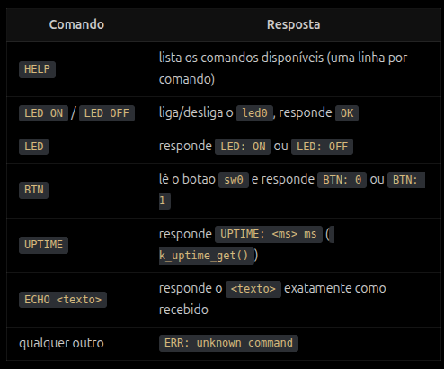

## Atividade 04 — Mini-shell via UARTCI

<<<<<<< HEAD
Repositório de atividades práticas da disciplina, em C/Zephyr. Cada
atividade vive numa branch própria (`Atividade-01`, `Atividade-02`, ...),
com o skeleton de código daquela atividade — este branch (`main`) não tem
código, só a explicação de como tudo funciona.

## Como funciona

1. As branches `Atividade-XX` contêm o skeleton de cada atividade (o
   enunciado, no README daquela branch, explica só o problema — sem
   entregar a solução).
2. Aluno faz **fork** deste repositório, cria/usa uma branch com o
   **mesmo nome da atividade** no fork e implementa a solução ali.
3. Aluno abre um **Pull Request** do fork pra este repositório, **contra
   `main`** — é o único branch alvo que dispara o CI (ver abaixo).
4. O CI builda, roda os testes e (quando a atividade tiver) faz uma
   checagem estrutural do código, comentando o resultado direto no PR.

## CI

<<<<<<< HEAD
PRs contra `main` disparam `.github/workflows/pr-check.yml`
(`pull_request_target`, necessário pra secrets chegarem em PR de fork), que
chama o workflow reutilizável do
[ECOM042-CI](https://github.com/JoaoMatheusND/ECOM042-CI) (clang-format,
build e testes internos via Twister, e checagem estrutural opcional via
`check.py`) usando o nome da branch do PR pra identificar a atividade.
Detalhes em `ECOM042-CI/README.md`.

Precisa de um Actions secret `ATIVIDADES_TOKEN` configurado neste repo
(Settings → Secrets and variables → Actions) — token fine-grained,
com acesso de leitura só ao repo privado
[ECOM042-atividades](https://github.com/JoaoMatheusND/ECOM042-atividades),
=======
PRs disparam `.github/workflows/pr-check.yml`, que chama o workflow
reutilizável do [ECOM042-CI](https://github.com/JoaoMatheusND/ECOM042-CI)
(clang-format, build e testes internos via Twister) usando o nome da branch
do PR pra identificar a atividade. Detalhes em `ECOM042-CI/README.md`.

Precisa de um Actions secret `ATIVIDADES_TOKEN` configurado neste repo
(Settings → Secrets and variables → Actions) — token com acesso de leitura
ao repo privado [ECOM042-atividades](https://github.com/JoaoMatheusND/ECOM042-atividades),
>>>>>>> 0d1e984 (CI: repassa ATIVIDADES_TOKEN pro workflow reutilizável)
que guarda o gabarito das atividades.
=======

Construa uma pequena shell de comandos que convesa por UART, simulado por native ou com placa real, na placa real mandar vídeo mostrando o funcionamento, no `native_sim` a UART é um pseudo-terminal do linux: ao rodar o executável, o Zephyr  imprime algo como `uart_1 connected to pseudotty: /dev/pts/N`, e você conversa com o firmware abrindo esse caminho em outro terminal (`screen /dev/pts/N`, `picocom /dev/pts/N`, ou `echo "HELP" > /dev/pts/N`): suporte em link anexo.

**CONTEXTO:**

O console (printk) já usa a `uart0`. Para não misturar log com o canal de comandos, use a `uart1` ou use o subsistema de LOG do zephyr.

**REQUISITOS:**

1. Comunicação

* UART(RX) deve ocorrer por interrupção, sem pooling.
* ISR da interrupção apenas enfileira os bytes, sem parsing.
* Uma **thread** consome os bytes, monta linhas terminadas em `\n` ou
  `\r` e despacha o comando.
* **TX** das respostas pela `uart1` (transmissão você escolhe)), terminando cada resposta com
  `\r\n`.

1. Linha de comando

* 
* Buffer de linha de tamanho fixo (64 bytes) em Kconfig. Linha maior que isso
  deve ser descartada por inteiro e responder `ERR: line too long`.
* **Backspace** (`0x08` ou `0x7F`) apaga o último caractere digitado.
* **Eco** dos caracteres digitados de volta pela UART, e prompt `> `
  após cada resposta.

1. Comandos (case-insensitive))

**ARQUITETURA**

* **Tabela de comandos com function pointers.**
* **Separar camadas**: pelo menos um módulo de *parsing/dispatch*
  (sem nenhuma chamada de UART, GPIO ou `printk`, só recebe a linha e
  devolve/escreve a resposta num buffer) e um módulo de *transporte*
  (UART). O `main.c` só inicializa e conecta as partes.
* LED e botão obtidos pelo **devicetree.**

### Testes unitários

11. **Obrigatório**: testes unitários com **ztest** em
    app de teste próprio (ex.: `tests/unit/` com `CMakeLists.txt`,
    `prj.conf`, `testcase.yaml` e `src/`), rodando no `native_sim` via
    `west twister`.
>>>>>>> 53c1e17 (feat: atividade 04)
